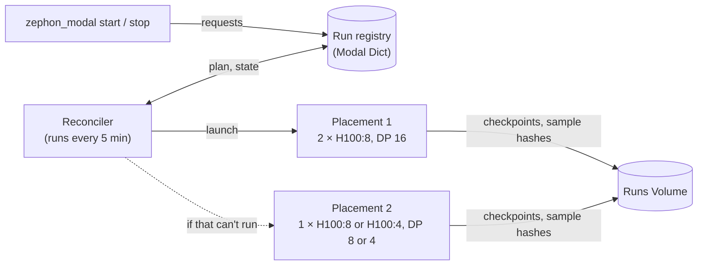

# zephon-modal

**Long training runs on [Modal](https://modal.com) that survive preemption,
move between GPU shapes, and can prove they trained on the right data.**

A multi-day run on Modal will get preempted, will hit Modal's 24-hour function
limit, and will sometimes find the GPUs it wants unavailable. zephon-modal
keeps that run going. You give it one training recipe and a ranked list of GPU
shapes it may use; it launches the run, resumes it from the latest checkpoint
after every interruption, and moves it to another shape when it has to.

Moving between shapes changes the data-parallel (DP) degree, and with most
data loaders that changes which samples each step trains on.
[Zephon](https://github.com/datologyai/zephon)'s loader doesn't: a run sees
the same samples at every step whether it's on 16 GPUs or 4. zephon-modal
hashes every sample a run trains on, so you can check that instead of taking
it on faith.

> **Status: early.** Built to carry multi-day torchtitan runs. Rehearsed on
> T4s and H100s, with injected stops, but not yet run for longer than a day.
> See [What's been tested](#whats-been-tested).

## How it works



- **A job** is a Python file holding one `ElasticJob`: your training image,
  how to launch the trainer, and where it may run.
- **Placements** are the GPU shapes the run may use, best first, such as a
  2-node H100:8 cluster, then a single node. Each becomes its own Modal
  function.
- **Adapters** launch a framework's trainer under torchrun. There are two:
  `Torchtitan` and `Megatron`.
- **The data contract** says which DP degrees are allowed. With
  `Zephon(canonical_replicas=16)`, the data is split into 16 lanes and the run
  can train on any DP degree that divides 16.
- **The reconciler** is a scheduled function in the job's Modal app. Every few
  minutes it checks each run and takes at most one step: launch, relaunch,
  move to the next placement, or give up. Nothing long-lived has to stay up.
- **Sample hashes** are the proof. Each DP rank records a hash of every
  sequence it trains on, per step. `compare` and `replays` check them.

[docs/design.md](docs/design.md) has the details: every decision the
reconciler makes, how a preempted run resumes cleanly, and why.

## Try it: the smoke test

`examples/smoke` runs the whole loop with a fake trainer on T4s, for a few
cents. You need a Modal account (`modal setup`) and [uv](https://docs.astral.sh/uv/).

```bash
git clone git@github.com:datologyai/zephon-modal.git && cd zephon-modal
uv sync --group dev
```

App and Volume names are shared across a Modal workspace, so prefix yours:

```bash
export ZEPHON_MODAL_SMOKE_PREFIX=<you>-smoke ZEPHON_MODAL_SMOKE_VOLUME=<you>-smoke-runs
```

1. Train a 40-step reference run on one T4:

   ```bash
   uv run python -m zephon_modal launch examples/smoke/job.py --run-id <you>-ref --steps 40 --placement t4x1
   ```

2. Start the run under test. `start` deploys the app and hands the run to the
   reconciler:

   ```bash
   uv run python -m zephon_modal start examples/smoke/job.py:preempt --run-id <you>-run --steps 40
   ```

3. Watch it with `status`. Once it has a checkpoint, stop its container to
   simulate a preemption, using the task ID `status` shows:

   ```bash
   uv run python -m zephon_modal status examples/smoke/job.py:preempt --run-id <you>-run
   modal container stop <task>
   ```

4. When it finishes, check it trained on the same samples as the reference,
   then stop the deployed app (it keeps its reconciler schedule until you do):

   ```bash
   uv run python -m zephon_modal compare examples/smoke/job.py --reference <you>-ref --candidate <you>-run --steps 40
   modal app stop <you>-smoke-preempt
   ```

You should see Modal restart the launch, the reconciler record the restart,
the run finish, and `compare` report 40/40 steps matching.

`examples/smoke/job.py` has other variants: `short_timeout` ends every launch
after two minutes (as a long run's launches end at 24 hours), and `fallback`
asks one function for either of two shapes.

## A real run: torchtitan on H100s

[examples/torchtitan](examples/torchtitan/README.md) is a runnable Qwen3-0.6B
job on [torchtitan-zephon](https://github.com/datologyai/torchtitan-zephon),
reading FineWeb-Edu. It moves between a 2-node H100:8 cluster and a single
H100:8-or-H100:4 node. Its README walks through staging the data, starting a
run, checking it, and rehearsing preemptions.

## Writing your own job

```python
import modal
from zephon_modal import ElasticJob, Placement, Torchtitan
from zephon_modal.zephon import Zephon

job = ElasticJob(
    name="qwen3",                       # the Modal app name
    image=training_image,               # framework + zephon>=0.2.1 + your recipe modules
    adapter=Torchtitan(module="my_recipes", config="qwen3_0p6b_zephon"),
    data=Zephon(canonical_replicas=16), # any DP degree dividing 16
    placements=[
        Placement("H100:8", nodes=2),                   # preferred: 2 nodes, DP 16
        Placement("H100:8", fallbacks=("H100:4",)),     # then one node, DP 8 or 4
    ],
    runs_volume=modal.Volume.from_name("my-runs", create_if_missing=True, version=2),
    volumes={"/data": modal.Volume.from_name("my-data")},
    compile_cache_volume=modal.Volume.from_name("my-compile-cache", create_if_missing=True, version=2),
    alert_secret=modal.Secret.from_name("my-slack-webhook"),  # optional: provides ZEPHON_MODAL_ALERT_WEBHOOK
)
```

Your recipe needs three changes to run under zephon-modal:

1. **Read the launch from zephon-modal.** Take `run_id` and the step target
   from `zephon_modal.context()`, and `canonical_replicas` and
   `aggregate_store` from `zephon_modal.zephon.settings()`.
2. **Hash samples.** In torchtitan, use `SampleHashingZephonDataLoader.Config`
   from `zephon_modal.zephon.torchtitan`. For Megatron-LM-zephon, use
   `Megatron(args="my_recipes:pretrain_args", script="pretrain_gpt_zephon.py",
   entry="zephon_modal.zephon.megatron_entry")`.
3. **Keep every checkpoint in the trainer** (torchtitan's `keep_latest_k=0`)
   and pass `--keep-checkpoints N` to `start` instead. On a multi-node cluster,
   a trainer that prunes its own checkpoints leaves partial ones behind;
   [docs/design.md](docs/design.md#preemption) explains why.

Run `placements` on your job file to see each placement's name and the DP
degree it gives.

## Commands

Every command takes the job file first (`path/to/job.py`, or
`path/to/job.py:attribute` if the job isn't named `job`). With a Zephon
install that has its CLI (`main` after v0.2.1), `zephon modal <command>` works
too.

| Command | What it does |
|---|---|
| `placements` | List the job's placements and the DP degree each gives. |
| `deploy` | Deploy the job's app (its reconciler and training functions). |
| `start --run-id R --steps N` | Deploy, then train run `R` to `N` total steps across placements. Starting a stopped or finished run again resumes it. |
| `status --run-id R` | Show the run's state, its current launch, and recent events. |
| `stop --run-id R` | Stop the run. Its launch stops the trainer and commits. |
| `recover --run-id R` | Continue a run whose last launch never confirmed it stopped. Check its containers are gone first. |
| `launch --run-id R --steps N --placement P` | Train on one placement now, without the reconciler. For reference runs and experiments. |
| `compare --reference A --candidate B` | Check two runs trained on the same samples at every step. |
| `replays --run-id R` | Check a run against itself: steps re-trained after a resume must match their first training. |
| `stop-after --run-id R --after 40 120` | Rehearse preemptions: stop the run's container after the checkpoints at those steps. |

`start` takes the reconciler's limits too: `--queue-timeout`,
`--max-restarts`, `--cooldown`, `--stall-timeout`, `--max-failures`,
`--max-lost`, `--keep-checkpoints` and `--max-gpu-hours`. See `--help` and
[what the reconciler decides](docs/design.md#what-it-decides-each-tick).

A deployed app keeps running its reconciler every few minutes until you
`modal app stop` it.

## Checking a run

There are two checks, both built on the sample hashes:

- **`replays`** needs no reference. Every resume re-trains the steps since the
  last checkpoint, often at a different DP degree, and those steps must match
  their first training. A long run collects this evidence at every resize for
  free.
- **`compare`** checks a run against a reference run, such as a short one
  made with `launch`. With `--steps N` it's strict: every step up to `N` must
  be present in both runs, from every DP rank, and match.

```bash
uv run python -m zephon_modal replays path/to/job.py --run-id <run>
uv run python -m zephon_modal compare path/to/job.py --reference <ref> --candidate <run> --steps 200 --rows-per-step 128
```

Hashing is optional and sits in the data path, so it's a deliberate choice;
[docs/design.md](docs/design.md#sample-hashes) covers what it does and doesn't
cover.

## What's been tested

**Exercised live, on T4s with the reconciler:** a stopped container restarted
by Modal and followed to completion; a launch ending at the function timeout,
draining and relaunching; `stop`, then `start` again resuming; checkpoint
pruning; and failed launches retried, then given up on, each after draining.

**On H100s:** torchtitan moving from a 2-node cluster (DP 16) to one node
(DP 8) after a stop, and Megatron restarting in place on a 2-node cluster.

Every one matched a reference run under the strict `compare`, and `replays`
matched across the resize.

**Not yet exercised:** a queue timeout under the reconciler (Modal allocated
every time), moving to another placement after a failure, the alert webhook,
`recover`, a real preemption (every stop so far was `modal container stop`),
and anything longer than a day. Before a long run, rehearse it with
`stop-after` on T4s, then on the real shape.

## Development

```bash
uv sync --group dev
uv run pytest
uv run ruff format . && uv run ruff check .
uv run pyright
```

The tests don't touch Modal. Only `zephon_modal/zephon/torchtitan.py` and
`megatron_entry.py` import training frameworks, and only inside training
images; the rest of the package imports without torch.

Apache-2.0.
